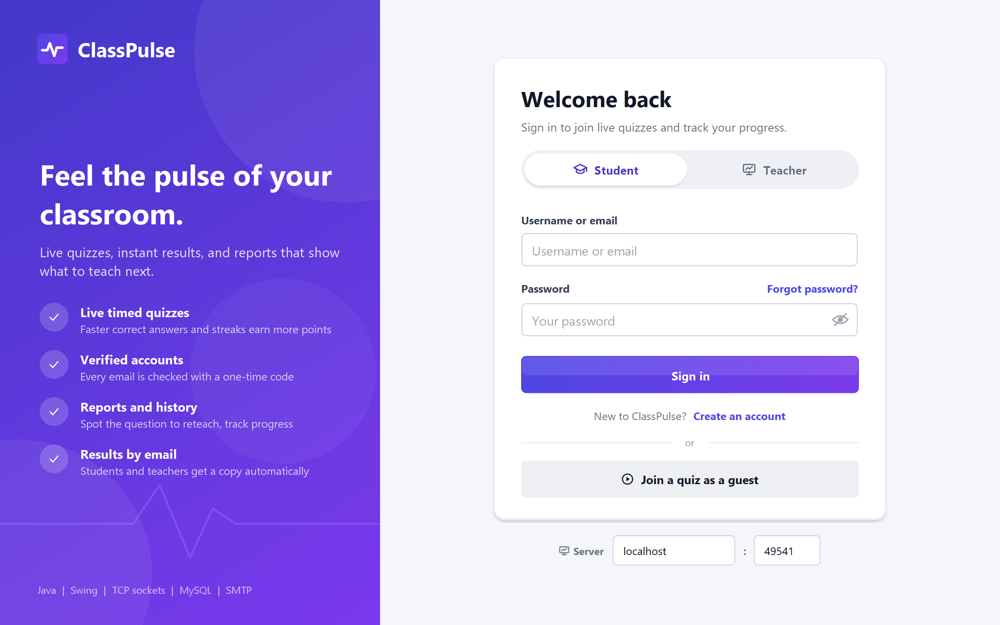
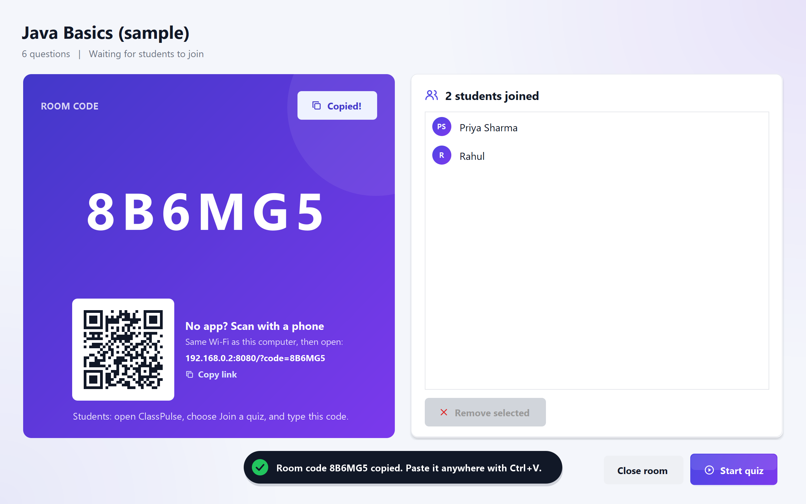
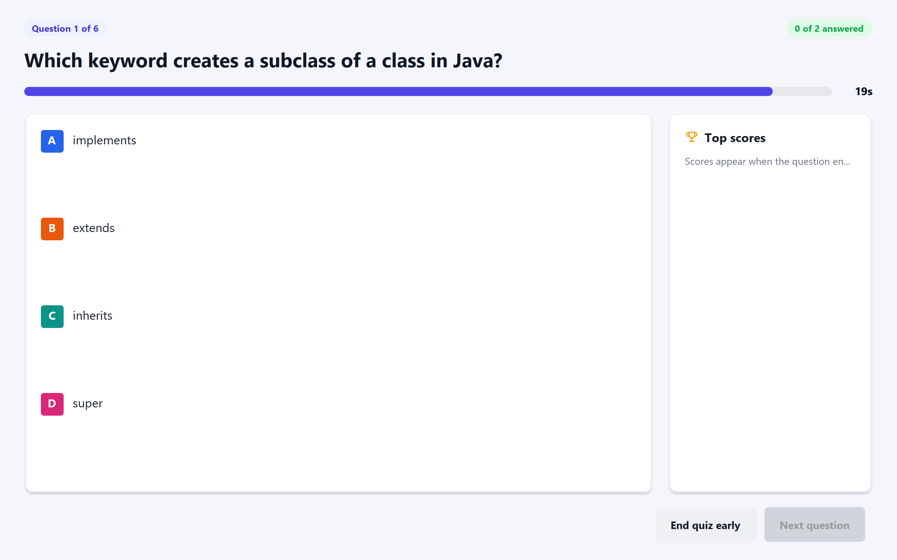
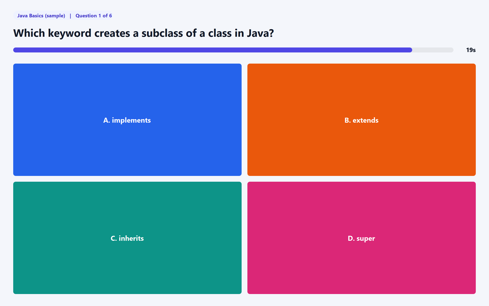
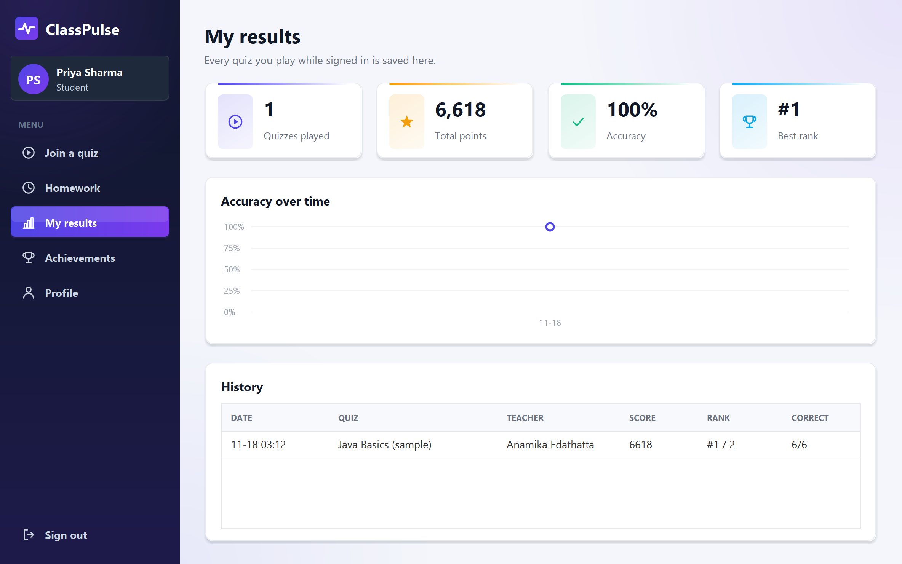
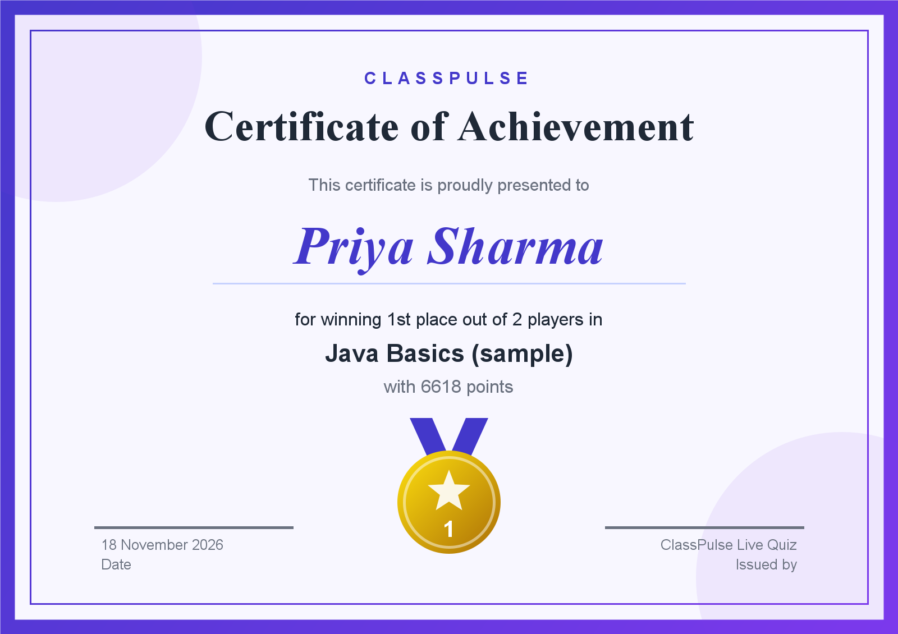
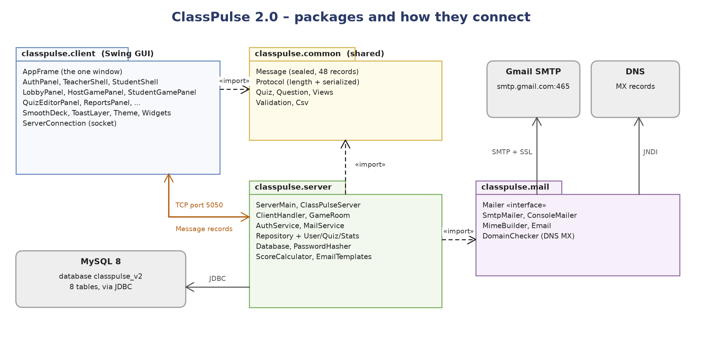

# ClassPulse: Live Classroom Quiz System

A client-server application for live, timed classroom quizzes. A teacher hosts a quiz, students join with a room code (from the desktop app or by scanning a QR code on their phone), and scores update after every question. Every game is saved in MySQL, and results, reports, homework reminders and certificates are sent by email.

Built in **pure Java 21** with no frameworks: Swing, TCP sockets, virtual threads, JDBC and SSL sockets, plus MySQL 8. About 13,000 lines of code with 40 automated tests.

*Object-Oriented Programming project at Vidyashilp University, by Anamika Edathatta.*

## Screenshots

| Teacher lobby: room code and QR code for phones | Teacher view while a question runs |
| --- | --- |
|  |  |
| **Student view of the same question** | **Student results and history** |
|  |  |

 <em>Winner's certificate, drawn with Java2D and attached to the result email</em>

## Features

**Live quizzes**
- Teachers create, edit, duplicate and delete quizzes, or import them from CSV, and host them live with a room code.
- Students answer in parallel; faster correct answers and answer streaks earn more points.
- Lobby management (remove a student), optional question shuffling, and a live leaderboard.
- **Phone play:** the lobby shows a QR code. Students on the same Wi-Fi scan it and play in the phone's browser, in the same game as desktop players, with nothing to install.

**Accounts and security**
- Teacher and student accounts with email verification (6-digit code), sign-in with username or email, and forgot/reset/change password.
- Passwords stored as salted **PBKDF2-HMAC-SHA256** hashes (120,000 iterations).
- All SQL uses prepared statements (tested against SQL injection), and repeated wrong passwords disconnect the client.
- Email checks: format, typo suggestions ("Did you mean @gmail.com?"), and a DNS **MX lookup** to reject domains that cannot receive mail.

**Reports, homework and email**
- Teacher dashboard, per-game reports with a "worth reteaching" insight, and CSV export.
- Classes with join codes, plus homework with deadlines. A background scheduler emails students when homework is set, reminds them before the deadline, and sends the teacher a summary with a CSV attachment.
- Student history with an accuracy chart, nine achievement badges, and certificates for winners.

## Technical highlights

- **Hand-written QR code generator**, including Reed-Solomon error correction and all 8 mask patterns, with no libraries (`common/QrCode.java`).
- **Hand-written SMTP client** over SSL sockets with its own MIME builder for HTML emails and attachments (`mail/SmtpMailer.java`, `mail/MimeBuilder.java`).
- **Custom TCP protocol** of length-prefixed, sealed `Message` records shared by client and server (`common/Protocol.java`, `common/Message.java`).
- **Virtual threads:** one per connected client, load-tested with 50 simultaneous students.
- **Built-in HTTP server** (`com.sun.net.httpserver`) that serves the phone web player and talks to the same game rooms as the desktop clients.
- **Layered server:** `ClientHandler` → services (`AuthService`, `HomeworkService`) → repositories (`UserRepository`, `QuizRepository`, ...) → MySQL. Email goes through a `Mailer` interface, so tests swap in a fake mailer.
- **Robustness:** the server survives random garbage bytes, client disconnects mid-game, and a teacher leaving (the room closes cleanly).

## Architecture

*Core packages and how they connect. Classes and homework later added 4 more tables (12 in total).*

| Package | Contents |
| --- | --- |
| `src/classpulse/common` | Messages, data records, wire protocol, validation, CSV, QR code |
| `src/classpulse/server` | Sockets, game rooms, scoring, accounts, homework, repositories, email templates, phone web server |
| `src/classpulse/mail` | SMTP client, MIME builder, console mailer, DNS mail-server check |
| `src/classpulse/client` | Swing screens, custom widgets and charts, client socket |
| `test` | Unit and integration tests (40) and an automated GUI walkthrough |

## Getting started

**Requirements:** JDK 21 or newer, and MySQL 8 on `localhost:3306`. The MySQL JDBC driver is included in `lib/`.

The scripts are for Windows:

1. Run `run-server.bat` and enter your MySQL password when asked. It creates the `classpulse_v2` database and all tables automatically.
2. Run `run-client.bat`, choose **Teacher**, then **Create an account**. In demo mode, the verification code is printed in the server window.
3. Open **My quizzes**, select a quiz and choose **Host live**. A room code and QR code appear.
4. Run `run-client.bat` again for each student (sign in, or **Join a quiz as a guest**) and enter the room code.
5. Choose **Start quiz** in the teacher window.

After changing code, run `build.bat`. On macOS or Linux, use the `javac`/`java` commands from the `.bat` files with `:` instead of `;` in the classpath.

**Phone play:** allow Java on **Private networks** when Windows asks. If the QR code shows the wrong address, start the server with `run-server.bat --phone-host 192.168.x.x`. `--phone-port off` turns phone play off.

### Email

Settings are in `config/mail.properties`.

- `mail.mode=console` (default): **demo mode**. Emails are printed in the server window and saved to `mail-outbox/`. No internet or email account needed.
- `mail.mode=smtp`: real email, for example through Gmail with an [App Password](https://myaccount.google.com/apppasswords). Put your address in `mail.smtp.username`; the server asks for the password at startup (or reads `CLASSPULSE_MAIL_PASSWORD`). It is never stored in a file.

## Tests

`run-tests.bat` runs 40 tests against a separate `classpulse_v2_test` database with a fake mailer:

- **Unit tests:** scoring and streaks, password hashing, validation, CSV import/export, protocol round trips, MIME format, QR code decoding, certificate rules.
- **Integration tests** (real sockets and real MySQL): a whole game end to end, SQL injection attempts, permissions, 50 concurrent students, garbage input, homework emails and reminders, and phone players over HTTP.

Latest run: [`docs/test-results.txt`](docs/test-results.txt) shows **40 passed, 0 failed**.

## CSV quiz format

Columns: `question, A, B, C, D, correct, seconds`. See [`sample-data/oop-concepts-quiz.csv`](sample-data/oop-concepts-quiz.csv).
